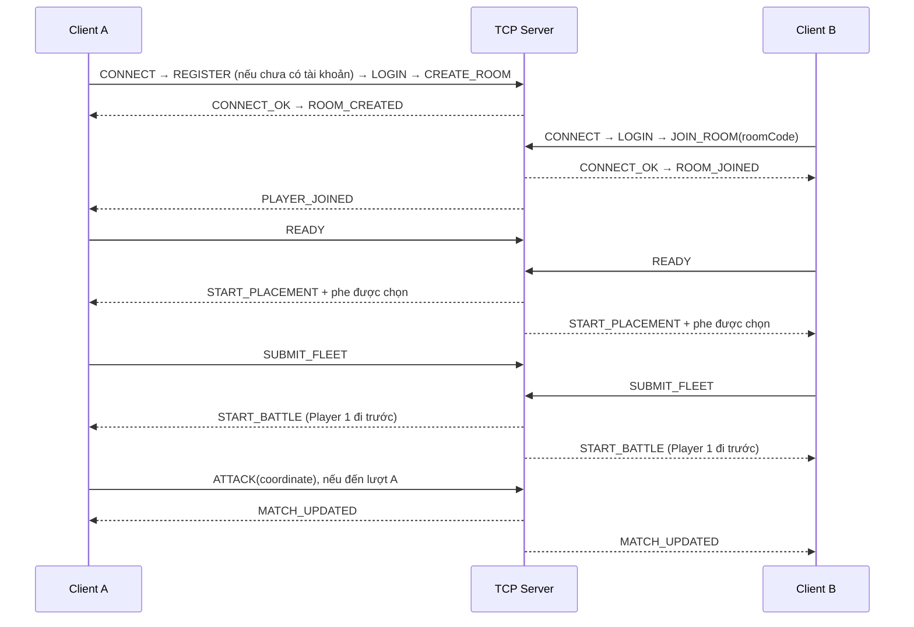

# Battleship 3D

Game desktop chiến thuật hải chiến trên bàn cờ 10×10, viết bằng **Java 25**.
Frontend dùng **jMonkeyEngine** để dựng không gian biển fantasy, lâu đài hai phe,
bàn cờ và mô hình tàu 3D. Backend dùng **Java TCP Socket** để quản lý phòng và trận PvP.

Định hướng theo báo cáo môn học và các điểm cần đối chiếu: [tài liệu tham chiếu](docs/requirements-reference.md).

## Chức năng hiện có

- **Bắt buộc đăng nhập:** mở ứng dụng → đăng ký/đăng nhập → Main Menu. Không còn chế độ Play Local.
- **Chat phòng/trận:** tin nhắn trực tiếp trong Waiting Room và Battle; tự tách nội dung giữa các ván.
- **Mời bạn vào PvP:** mời bạn online, Accept/Decline, thời hạn 60 giây; tự tạo hoặc dùng lại phòng chờ.
- **Friends:** tìm username, gửi/nhận/chấp nhận/từ chối/hủy lời mời, xóa bạn có xác nhận; cập nhật hai phía qua TCP và hiển thị online/offline.
- **Leaderboard:** xếp hạng toàn server theo số trận thắng, tỷ lệ thắng hoặc số trận; 10 người/trang.
- **Fleet designer:** tự vẽ hình tàu liền cạnh, model 3D dựng theo đúng vùng ô; chọn chế độ trong màn hình cấu hình phòng PvP.
- **PvP:** tạo phòng, tham gia bằng mã 6 ký tự, phòng chờ hai người, Ready/Not Ready,
  xếp tàu và đánh trận qua TCP.
- Server chọn ngẫu nhiên phe trắng/đen khi bắt đầu xếp tàu; Player 1 trong phòng đi trước, độc lập với màu phe.
  Góc nhìn ban đầu của mỗi người hướng về lâu đài đối thủ.
- Kiểm tra vị trí tàu, giới hạn bàn cờ, chồng lấn, lượt bắn, hit/miss/sunk và thắng/thua.
- Hỗ trợ đặt mới, kéo thả, xoay, xóa, reset và random đội tàu; minimap và hiệu ứng bắn.

**PvP → Create Room → Room Settings → Create Room**: chọn Basic (tàu thẳng)
hoặc Fleet Designer (vẽ tàu), số tàu 3–5, và luật bắn. Join Room chỉ cần nhập mã;
người tham gia nhận cùng cấu hình từ server. Cấu hình giữ nguyên khi chơi lại.

- 3 tàu: Carrier (5 ô), Battleship (4 ô), Cruiser (3 ô).
- 4 tàu: thêm Submarine (3 ô).
- 5 tàu: thêm Destroyer (2 ô).
- **Alternate shots:** mọi phát bắn hợp lệ đều chuyển lượt.
- **Hit grants another shot:** bắn trúng hoặc đánh chìm được bắn tiếp; trượt thì chuyển lượt.

Player 1 mở trận. Mỗi phát bắn hợp lệ bắt đầu cửa sổ 60 giây tiếp theo (kể cả
khi giữ lượt); bắn sai/bắn trùng không đặt lại đồng hồ. Hết giờ vẫn thua ngay.
Tàu không được chồng lấn hoặc nằm ngoài bàn cờ. Server xác thực số lượng,
đúng các loại tàu đã chọn, hình dạng và lượt chơi; client không tự quyết định luật.

**Settings** đã hoạt động: cửa sổ/toàn màn hình không viền, kích thước cửa sổ, độ nhạy orbit/zoom và lưu cấu hình cục bộ.
**Profile** hiện hiển thị tài khoản và đăng xuất; chưa có màn lịch sử/thống kê cá nhân.
PvE / VS AI chưa được triển khai; đã bỏ nút không có tác dụng khỏi menu demo.
Đã có tài khoản và lưu kết quả PvP bằng PostgreSQL; có chat trong phòng/trận; chưa có chat riêng hoặc khôi phục trận sau mất kết nối.

Kết thúc trận hiển thị Victory/Defeat theo từng người. **PLAY AGAIN** trong PvP
gửi yêu cầu đến server: một người đồng ý thì chờ trên màn kết quả, cả hai đồng ý
thì cùng về xếp tàu trong phòng hiện tại. Ván mới xóa đội hình, lịch sử bắn,
thắng/thua và timer cũ. **DECLINE** hủy yêu cầu đang chờ, giữ kết quả trận.
**MAIN MENU** rời phòng và về menu; nếu đối thủ còn ở màn kết quả, họ nhận
thông báo hủy chơi lại và vẫn giữ kết quả đó.

## Cấu trúc dự án

```text
LTM_battleship/
├── frontend/             # Client desktop, UI, input và render 3D
│   └── src/
│       ├── main/java/com/battleship/frontend/
│       │   ├── app/      # Khởi động và điều hướng màn hình
│       │   ├── settings/ # Cấu hình desktop cục bộ, UI và lưu file
│       │   ├── menu/     # Main Menu
│       │   ├── pvp/      # Giao diện phòng và gửi lệnh PvP
│       │   ├── network/  # TCP client, luồng gửi/nhận
│       │   ├── game/     # Tương tác bàn cờ, HUD, minimap và hiển thị gameplay
│       │   └── ...       # camera, scene, graphics, effects
│       ├── main/resources/
│       └── test/java/
├── backend/              # Server, không cần giao diện hoặc GPU
│   └── src/main/java/com/battleship/backend/
│       ├── server/       # ServerSocket, kết nối và phiên client
│       ├── room/         # Thành viên, mã phòng, Ready và phân phe
│       ├── match/        # Trận PvP và repository lưu kết quả
│       ├── auth/         # Xác thực, password hashing và user repository
│       └── database/     # Cấu hình JDBC và migration
├── shared/               # Code thuần Java dùng chung
│   └── src/main/java/com/battleship/shared/
│       ├── game/         # Model và luật Battleship
│       ├── room/         # DTO và trạng thái phòng
│       ├── match/        # Lệnh và snapshot trận
│       └── protocol/     # Message, JSON codec và handshake
├── docs/                 # Ảnh tham chiếu và ảnh kiểm tra scene
├── gradle/               # Gradle Wrapper
├── settings.gradle
└── build.gradle
```

Frontend và backend cùng phụ thuộc `shared`. Shared không phụ thuộc jMonkeyEngine;
backend không phụ thuộc frontend. Luật chơi nằm trong `shared.game.GameEngine`;
server sở hữu trạng thái trận PvP. Renderer/UI không trực tiếp đọc hoặc ghi socket.

## Giao tiếp giữa các client

Hai client **không kết nối trực tiếp với nhau**. Mỗi client giữ một kết nối TCP
đến cùng backend; backend kiểm tra lệnh rồi đẩy cập nhật đến người trong phòng.



Server xác nhận đủ các loại tàu trong cấu hình phòng (3–5 tàu) trước khi bắt đầu Battle. Đội hình sai bị từ chối
kèm lý do (thiếu/trùng loại tàu, thiếu dữ liệu, vượt biên hoặc chồng lấn); người chơi
có thể sửa và gửi lại. Kích thước tàu được server suy ra từ `ShipType`, không tin
kích thước hay danh sách ô do client tự khai báo. Người Ready trước chờ người còn lại,
đội hình đã xác nhận bị khóa. Player 1 là người ở vị trí đầu tiên trong phòng chờ.
Mỗi lượt bắn hợp lệ
được giải quyết trên server; chuyển lượt hay giữ lượt khi trúng theo luật của phòng.
Mỗi lượt PvP có **60 giây**, bắt đầu khi trận vào Battle và đặt lại sau mỗi phát
bắn hợp lệ. Bắn sai hoặc bắn trùng không đổi lượt, không đặt lại thời gian.
Hết giờ, người đang có lượt thua; server gửi kết quả cho cả hai client.
Mỗi người nhận snapshot riêng: toàn bộ board của mình, các ô đã bắn trên board
đối thủ và tàu đối thủ đã chìm; vị trí tàu chưa lộ không được gửi sang client.

### Protocol và đồng bộ

Message có ba trường, ví dụ lệnh bắn:

```json
{
  "type": "ATTACK",
  "requestId": "550e8400-e29b-41d4-a716-446655440000",
  "payload": { "coordinate": { "row": 2, "column": 4 } }
}
```

`row` và `column` bắt đầu từ 0. `requestId` liên kết phản hồi với yêu cầu tương ứng.
JSON được mã hóa UTF-8 và truyền theo frame:

```text
[4 byte độ dài JSON, big-endian][JSON UTF-8 đúng số byte đã khai báo]
```

Phần JSON tối đa 65.536 byte. Length prefix giúp đọc đúng message khi TCP chia
một message thành nhiều đoạn hoặc gộp nhiều message trong một lần nhận.

| Nhóm | Message chính |
| --- | --- |
| Kết nối | `CONNECT`, `CONNECT_OK`, `PING`, `PONG`, `DISCONNECT` |
| Tài khoản | `REGISTER`, `REGISTER_OK`, `LOGIN`, `LOGOUT`, `LOGOUT_OK`, `AUTH_SUCCESS`, `AUTH_FAILED` |
| Phòng | `CREATE_ROOM`, `JOIN_ROOM`, `ROOM_CREATED`, `ROOM_JOINED`, `PLAYER_JOINED`, `ROOM_UPDATED` |
| Sẵn sàng/rời phòng | `READY`, `NOT_READY`, `START_PLACEMENT`, `LEAVE_ROOM`, `ROOM_LEFT`, `PLAYER_LEFT` |
| Trận đấu | `SUBMIT_FLEET`, `FLEET_ACCEPTED`, `START_BATTLE`, `ATTACK`, `MATCH_UPDATED`, `TURN_TIMER` |
| Xếp hạng | `LEADERBOARD_REQUEST`, `LEADERBOARD_RESULT`, `LEADERBOARD_ERROR` |
| Chơi lại | `REMATCH_REQUEST`, `REMATCH_DECLINE`, `REMATCH_UPDATED` |
| Lệnh bị từ chối | `ERROR` |

Gửi/nhận socket chạy ở thread riêng. Client chuyển sự kiện về render thread để
cập nhật UI an toàn, vẫn cập nhật khi cửa sổ mất focus. Server có hàng đợi gửi
giới hạn cho từng kết nối để socket chậm không chặn việc xử lý phòng.
Snapshot trận có `revision`; client bỏ qua bản lặp hoặc cũ.
Server dùng `System.nanoTime()` để quyết định hết giờ, đồng thời gửi `TURN_TIMER`
khoảng mỗi giây. Client chỉ nội suy thời gian còn lại để hiển thị, không tự xử
thắng/thua. Timeout và lệnh bắn được xử lý dưới cùng khóa; phát bắn được xử lý
tại hoặc sau deadline bị từ chối. Không có timer riêng tồn đọng từ lượt cũ.
Heartbeat `PING/PONG` duy trì kết nối. Khi một người rời hoặc mất kết nối trong Battle,
server xử thua người đó, gửi Victory cho đối thủ và lưu kết quả `PLAYER_LEFT`.
Trong Waiting Room/Placement, server cập nhật thành viên và đưa người còn lại về phòng chờ.
Nếu trận đã kết thúc, kết quả được giữ nguyên và yêu cầu chơi lại bị hủy.
Màn kết quả hiển thị lý do kết thúc: phá hủy hạm đội, hết giờ hoặc người chơi rời trận.
Timeout đã xảy ra được ưu tiên khi yêu cầu rời trận đến đúng/sau deadline; kết quả không bị ghi đè.

## Chạy sau khi clone

### Yêu cầu

- Git và **JDK 25**; cấu hình `JAVA_HOME` trỏ đến JDK 25.
- Frontend cần driver đồ họa hỗ trợ **OpenGL 3.2**; có thể dùng GPU onboard.
- Có Internet trong lần build đầu để tải Gradle và thư viện. Không cần cài Gradle riêng.
- Backend cần Java và PostgreSQL; Docker Desktop/Engine + Compose để chạy database. Không cần GPU.

Dự án dùng Gradle Wrapper 9.1.0, jMonkeyEngine 3.8.1-stable và Gson 2.13.2.

Thay `URL_REPOSITORY` bằng URL Git thực tế:

```bash
git clone URL_REPOSITORY LTM_battleship
cd LTM_battleship
java -version
```

Mở chính thư mục chứa `settings.gradle` trong IDE và import dưới dạng Gradle project.

### PostgreSQL và tài khoản

Chỉ PostgreSQL chạy trong Docker; Java backend/frontend vẫn chạy trực tiếp.
Tại thư mục gốc, sao chép cấu hình rồi đặt `DB_PASSWORD` riêng (không để trống):

```powershell
Copy-Item .env.example .env
# Sửa .env: DB_HOST, DB_PORT, DB_NAME, DB_USER, DB_PASSWORD
# Khởi động Docker Desktop trước, sau đó:
docker compose up -d --wait
docker compose ps
docker compose logs --tail=50 postgres
```

macOS/Linux dùng `cp .env.example .env`. `.env` đã được git-ignore.
Database chỉ được publish trên localhost; client không kết nối PostgreSQL.
Backend đọc `.env` trong thư mục chạy (hoặc thư mục gốc khi chạy từ `backend/`);
biến môi trường của tiến trình ưu tiên hơn file. Không đưa `.env` lên Git.
Khi triển khai bản `installDist`, đặt `.env` trong thư mục chạy hoặc export các biến `DB_*`.

Backend tự chạy script `backend/src/main/resources/db/V001__accounts_and_matches.sql`
trước khi mở TCP. Script chạy trong transaction, dùng khóa migration và `IF NOT EXISTS`;
chạy lại không xóa dữ liệu. Dữ liệu nằm trong named volume `postgres_data`.
Dừng/khởi động lại thông thường:

```powershell
docker compose stop postgres
docker compose start postgres
# Hoặc khởi động lại tiến trình PostgreSQL:
docker compose restart postgres
```

Không xóa volume khi dừng dịch vụ. Thay biến DB_USER/DB_PASSWORD sau khi volume đã có
không tự đổi tài khoản PostgreSQL đã khởi tạo; cần dùng đúng thông tin đã tạo hoặc đổi bằng SQL.

Ứng dụng mở thẳng form tài khoản. Phải đăng nhập thành công mới vào Main Menu và các chức năng game.
Dòng **SERVER: ... / CHANGE** mở form IP/hostname và TCP port: nhập địa chỉ backend,
chọn **CONNECT TO SERVER**, sau đó đăng nhập. Port phải từ 1 đến 65535; **BACK** hủy chỉnh sửa.
Gửi/nhận vẫn qua network layer riêng, không chặn render thread. Địa chỉ chỉ giữ trong lần chạy hiện tại;
tham số `-PserverHost`/`-PserverPort` vẫn dùng để chọn giá trị ban đầu.
Chọn **CREATE AN ACCOUNT**, nhập username/mật khẩu/xác nhận; đăng ký xong chuyển
về **SIGN IN** để đăng nhập. Username gồm 3–24 chữ ASCII, số hoặc `_`, không phân biệt
hoa/thường. Mật khẩu 12–128 ký tự. **PROFILE → SIGN OUT** đăng xuất; về Main Menu
vẫn giữ phiên đăng nhập. Không lưu mật khẩu trên đĩa phía client.
Đăng xuất đưa về form đăng nhập và khóa Main Menu. Trước khi đăng nhập, nút **EXIT** đóng ứng dụng; không có đường bỏ qua đăng nhập.

Server gắn tài khoản với kết nối TCP sau `AUTH_SUCCESS`; `CONNECT.playerName`, user ID
hoặc username tự thêm vào lệnh phòng không cấp quyền. Tất cả lệnh phòng/trận đều cần xác thực.
Một tài khoản chỉ có một phiên đăng nhập. Đăng xuất giải phóng phiên; hãy rời phòng trước khi đăng xuất.
Password hashing dùng PBKDF2-HMAC-SHA256, 600.000 vòng, salt ngẫu nhiên riêng 16 byte,
so sánh hằng thời gian; không lưu/gửi password hash về client.
Thông số theo [OWASP Password Storage](https://cheatsheetseries.owasp.org/cheatsheets/Password_Storage_Cheat_Sheet.html).
TCP hiện chưa mã hóa TLS: dùng mạng tin cậy/VPN khi truyền thông tin đăng nhập;
triển khai công khai cần lớp mã hóa TCP/TLS trước khi dùng tài khoản thật.

`users` lưu tài khoản và `last_seen_at` khi đăng nhập/đăng xuất; `matches` và `match_players` lưu thời gian, kết quả, nguyên nhân
(`FLEET_DESTROYED`, `TURN_TIMEOUT`, `PLAYER_LEFT`) cùng số phát bắn/hit/tàu chìm theo tài khoản.
Migration `V002__match_summary.sql` thêm `mode`, `winner_slot`, `total_turn`, `player_type`;
`total_turn` đếm số phát bắn hợp lệ đã xử lý, không tính lượt bỏ dở khi hết giờ hoặc rời trận.
Dữ liệu cũ được giữ và bổ sung tổng kết từ các thống kê đã có; lịch sử `ABORTED` cũ không bị đổi kết quả.
Chỉ bắt đầu ghi trận khi cả hai đội hình hợp lệ vào Battle; mỗi rematch có ID mới.
Ghi lịch sử chạy trong hàng đợi riêng, transaction; lỗi ghi được log, không chặn lượt bắn.
Chưa có màn hình lịch sử trận hoặc đặt lại mật khẩu trong phạm vi này.

### Windows / PowerShell

Build dự án:

```powershell
.\gradlew.bat build
```

Chạy client, đăng ký/đăng nhập rồi chọn **PVP** để chơi:

```powershell
.\gradlew.bat :frontend:run -PplayerName="Player A"
```

Thử PvP trên một máy: mở **ba terminal** tại thư mục gốc, mỗi terminal chạy một lệnh:

```powershell
# Terminal 1: server
.\gradlew.bat :backend:run
# Terminal 2: client A
.\gradlew.bat :frontend:run -PplayerName="Player A"
# Terminal 3: client B
.\gradlew.bat :frontend:run -PplayerName="Player B"
```

Mỗi client đăng ký/đăng nhập bằng **hai tài khoản khác nhau**. Trên client A chọn
**PVP → Create Room → cấu hình → Create Room**; client B chọn **PVP → Join Room** và nhập mã.
Cả hai Ready trong Waiting Room để vào xếp tàu. Xếp đủ số tàu của phòng rồi Ready lần nữa;
server khóa đội tàu đã gửi và bắt đầu Battle khi cả hai hoàn tất.

### macOS / Linux

Dùng JDK 25 đúng kiến trúc máy và thay `.\gradlew.bat` bằng `sh gradlew`:

```bash
sh gradlew build
sh gradlew :backend:run
# Terminal khác:
sh gradlew :frontend:run -PplayerName="Player A"
```

Launcher frontend trên macOS thêm `-XstartOnFirstThread`.
Các kiểm tra 3D hiện đã chạy trên Windows; chưa xác nhận trực tiếp trên macOS/Linux.

### Hai máy khác nhau

Máy A chạy backend; client trên A có thể dùng mặc định `localhost:2209`.
Máy B clone cùng phiên bản source, cài JDK 25 và chạy:

```powershell
.\gradlew.bat :frontend:run -PserverHost=192.168.1.10 -PserverPort=2209 -PplayerName="Player B"
```

Thay `192.168.1.10` bằng IPv4 của máy A, xem bằng `ipconfig` trên Windows.
Hai máy phải truy cập được nhau; máy A cho phép inbound **TCP 2209** qua firewall.
`localhost` trên máy B chỉ đến chính máy B, không đến server trên A.

Nếu khác mạng Internet, dùng server có IP/domain truy cập được, hoặc VPN/port forwarding.
Mã phòng chỉ chọn phòng bên trong server, không tự tìm server hay vượt NAT.

| Tham số client | Mặc định | Ý nghĩa |
| --- | --- | --- |
| `-PserverHost=...` | `localhost` | IP/domain backend |
| `-PserverPort=...` | `2209` | TCP port backend |
| `-PplayerName="..."` | `Captain` | Tên handshake; tên trong game lấy từ tài khoản |

Đổi port server bằng `.\gradlew.bat :backend:run --args="2210"`, sau đó dùng
`-PserverPort=2210` cho các client. Khi chạy Java trực tiếp, các JVM property tương ứng
là `battleship.host`, `battleship.port`, `battleship.player`.

## Settings và chuẩn bị demo

Main Menu có **PVP, LEADERBOARD, CREATE ROOM, JOIN ROOM, FRIENDS, PROFILE, SETTINGS, EXIT**.
Từ **SETTINGS**:

- **WINDOW MODE**: cửa sổ hoặc toàn màn hình không viền ở độ phân giải gốc của màn hình đang chứa cửa sổ. Chuyển chế độ giữ nguyên kết nối TCP và tài nguyên 3D.
- **WINDOWED SIZE**: chọn trong 960×600, 1280×720, 1440×900, 1600×900, 1920×1080 nếu vừa vùng làm việc của màn hình. Chỉ chỉnh khi ở chế độ cửa sổ; cửa sổ cũng có thể kéo giãn thủ công.
- **ORBIT / ZOOM SENSITIVITY**: 50–200%, mặc định 100%; giữ nguyên góc nhìn và giới hạn camera hiện có.
- **APPLY & SAVE** áp dụng và ghi file; **RESET TO SAVED** bỏ bản chỉnh chưa lưu, **BACK / Esc** về màn hình trước đó (kể cả trận đang chơi) và bỏ chỉnh sửa chưa lưu.
- **Audio** bật/tắt và chỉnh âm lượng tổng cho 34 WAV tải có giấy phép: 29 hiệu ứng, 3 bản nhạc theo màn hình và 2 lớp sóng/gió. Volume/mute được lưu cùng Settings; hiệu ứng và nhạc chạy trên luồng riêng bằng Java Sound. Nguồn, ghi công và cách tải lại: `sounds/ORIGIN.md`, `sounds/manifest.json` và [review âm thanh](docs/downloaded-audio-review.md).

**Mỗi lần mở app luôn bắt đầu ở Windowed**, kể cả file cấu hình cũ lưu `fullscreen=true`.
**Alt+Enter** hoặc Settings cho phép bật fullscreen khi đang sử dụng.
Windowed có thanh tiêu đề/nút thu nhỏ, phóng to, đóng; fullscreen dùng đúng màn hình đang chứa cửa sổ.
Trong fullscreen, con trỏ được vẽ trong GUI để không phụ thuộc hình chuột native sau Alt+Tab; Windowed dùng con trỏ hệ thống.

File cấu hình: `%USERPROFILE%\.battleship\settings.properties` trên Windows,
`~/.battleship/settings.properties` trên macOS/Linux. Kích thước và độ nhạy được khôi phục khi mở lại; chế độ khởi động luôn là Windowed. File sai định dạng dùng mặc định và có thông báo trong Settings.
Lưu file chạy riêng khỏi render thread; lỗi ghi được báo và khôi phục giá trị trước đó.
Cấu hình chỉ chứa màn hình/độ nhạy, không lưu mật khẩu. Chỉ kích thước chọn bằng **APPLY & SAVE** được lưu, không tự lưu thao tác kéo giãn cửa sổ.
Khi cần hai cấu hình độc lập để kiểm thử bằng Java trực tiếp, đặt `-Dbattleship.settingsFile=<đường-dẫn-file>` cho từng client.

Demo trên một máy: khởi động Docker và database bằng các lệnh ở trên → build → chạy server và hai client trong ba terminal.
Dùng hai tài khoản khác nhau, client A tạo phòng, client B nhập mã; hoặc kết bạn rồi **INVITE TO BATTLE → ACCEPT**.
Cả hai Ready phòng → xếp đủ 3–5 tàu theo cấu hình → Ready đội hình → Battle. Luật chuyển/giữ lượt theo phòng; có 60 giây cho mỗi phát bắn hợp lệ tiếp theo.
Thử chat chờ/trận, kết quả, **PLAY AGAIN** ở cả hai phía rồi một ván mới trong cùng phòng.
**MAIN MENU** rời phòng nhưng không dừng server; **PROFILE → SIGN OUT** về đăng nhập. **EXIT** chỉ đóng client đó.
Sau trận, mở/Refresh Leaderboard để đọc kết quả đã lưu; Profile chưa có trang lịch sử riêng.

Nếu server báo `Address already in use`, đã có tiến trình giữ port (thường là server cũ).
Dùng server đang chạy hoặc dừng đúng terminal server cũ; không chạy hai server cùng port.
Có thể dùng `:backend:run --args="2210"` và `-PserverPort=2210` ở cả hai client.
Không cần dừng hay xóa volume database khi chạy lại demo.

## Leaderboard

Đăng nhập → **LEADERBOARD** trong Main Menu. Có **WINS**, **WIN RATE**, **MATCHES**,
**PREVIOUS/NEXT**, **REFRESH** và **MAIN MENU**. Tự tải lại khi mở màn hình; mỗi trang tối đa 10 người.
Chỉ người đã có ít nhất một trận PvP hoàn tất được xếp hạng. Không tạo dữ liệu mẫu trên bảng thật.

- Mặc định: số thắng giảm dần → tỷ lệ thắng giảm dần → tổng trận giảm dần → username → ID, bảo đảm thứ tự ổn định.
- **WIN RATE**: tối thiểu **10 trận PvP hoàn tất**; sắp theo tỷ lệ → số thắng → tổng trận → username → ID.
- **MATCHES**: tổng trận → số thắng → tỷ lệ → username → ID.
- Chỉ tính `mode=PVP`, `status=FINISHED`, có thời điểm/lý do kết thúc và đủ hai người thật với đúng một Victory/một Defeat, khớp `winner_slot`.
  Timeout 60 giây và xử thua do rời trận hợp lệ đều được tính. BATTLE, ABORTED, PvAI hoặc bản ghi thiếu/mâu thuẫn bị loại.
- Chuỗi thắng tính theo thời điểm kết thúc, rồi thời điểm bắt đầu; dấu `-` khi lịch sử có thắng/thua cùng hai mốc thời gian khiến thứ tự không xác định được.
- Backend chờ các bản ghi kết quả đã xếp hàng được lưu trước khi truy vấn. Refresh sau lỗi lưu chỉ phản ánh dữ liệu thực sự đã ghi; không suy số trận từ client.

Frontend dùng chung kết nối TCP đăng nhập; truy vấn PostgreSQL và kiểm tra yêu cầu nằm ở backend.
SQL tổng hợp ở database, chỉ trả một trang cùng tổng số người đủ điều kiện. Không có cache xếp hạng phía client.

## Điều khiển

| Chuột/phím | Thao tác |
| --- | --- |
| Kéo chuột trái ở vùng biển trống | Orbit camera |
| Cuộn chuột / R | Zoom / reset camera |
| 1–5 hoặc chọn trong panel | Chọn loại tàu |
| Click ô trống | Đặt tàu mới |
| Kéo thả tàu đã đặt | Di chuyển tàu |
| T / Delete | Xoay / xóa tàu đang chọn |
| C / F | Reset / random đội tàu |
| Enter | Ready khi đủ số tàu theo phòng |
| Click ô trong Battle | Gửi lệnh bắn |
| Tab | Đổi board đang xem |

Trong PvP, chỉ được bắn khi đến lượt mình và đang xem board đối thủ.

## Đóng gói backend lên server

```powershell
.\gradlew.bat :backend:build :backend:installDist
```

Upload **toàn bộ** `backend/build/install/backend/`, gồm `bin/` và `lib/`, lên máy chủ
có Java 25. Trên Linux, tại thư mục đã upload:

```bash
sh bin/backend 2209
```

Mở TCP port tương ứng trong firewall/security group; dùng IP/domain máy chủ làm
`serverHost` của tất cả client. Khi vận hành lâu dài, chạy backend dưới service manager
như systemd. Server cần hỗ trợ TCP trực tiếp; frontend 3D vẫn chạy trên máy người chơi.
Phòng/trận đang chơi lưu trong RAM; khởi động lại server mất trạng thái đang chơi.
Tài khoản và lịch sử trận đã ghi vẫn giữ trong PostgreSQL.

## Kiểm tra và xử lý lỗi

`build` chạy kiểm tra luật chơi, mapping tọa độ, password hashing và Settings (file cấu hình/độ nhạy), không cần database.
Kiểm tra PostgreSQL/TCP chạy riêng khi database đã healthy và `.env` đã cấu hình:

```powershell
.\gradlew.bat build -PdatabaseChecks
```

Lệnh trên kiểm tra đăng ký/login/logout, username trùng, identity giả, phiên trùng,
migration lặp, hash trong database, thống kê trận và các trận TCP/rematch.
Các kiểm tra tạo tài khoản QA với tên duy nhất trong database phát triển.
Các kiểm tra giao diện cần môi trường OpenGL:

```powershell
.\gradlew.bat :frontend:checkGameplayRendering :frontend:checkMainMenu
# Cần backend chạy riêng tại localhost:2209:
.\gradlew.bat :frontend:checkPvpRooms
.\gradlew.bat :frontend:checkAccountScreens
.\gradlew.bat :frontend:checkPvpDisconnect
.\gradlew.bat :frontend:checkLeaderboardScreens
.\gradlew.bat :frontend:checkFriendsScreens
.\gradlew.bat :frontend:checkGameInviteScreens
.\gradlew.bat :frontend:checkChatScreens
.\gradlew.bat :frontend:checkSettingsScreens
```

| Vấn đề | Kiểm tra |
| --- | --- |
| Không tìm thấy JDK 25 | Kiểm tra `java -version`, `JAVA_HOME` và Gradle JVM trong IDE |
| Connection refused / timeout | Server đã chạy, đúng IP/port, firewall và đường mạng có cho phép TCP không |
| Port đã được sử dụng | Dừng server cũ hoặc chọn port khác cho cả server/client |
| Join đưa về đăng nhập | Xem lý do trên form và dòng `TCP ended ... reason=...` trong Terminal client; đối chiếu `Connection ended` ở server. Lỗi mã phòng thông thường không đăng xuất. Dùng cùng phiên bản source trên hai máy. |
| Không tạo được OpenGL context | Cập nhật driver GPU; Windows có thể thử `.\gradlew.bat :frontend:runIntegrated` |

Windows launcher ưu tiên GPU hiệu năng cao và thử onboard nếu khởi tạo OpenGL thất bại;
không bật/tắt thiết bị GPU. Onboard vẫn cần driver OpenGL hoạt động.
Frontend và backend nên dùng cùng phiên bản source/protocol.

Font Cormorant Garamond và Manrope có giấy phép SIL OFL trong
`frontend/src/main/resources/fonts/`.

Kiểm tra dữ liệu Leaderboard dùng **database kiểm thử mới, riêng biệt** để không thêm lịch sử mẫu vào database game.
Ví dụ trên môi trường Docker phát triển (tên phải bắt đầu bằng `battleship_lb_test_`):

```powershell
docker compose exec -T postgres psql -U battleship -d postgres -c "CREATE DATABASE battleship_lb_test_manual"
.\gradlew.bat :backend:checkLeaderboard -PleaderboardDatabase=battleship_lb_test_manual
```

Thay username `battleship` nếu `.env` dùng DB_USER khác. Test yêu cầu database mới/chưa có user;
bao phủ dữ liệu rỗng/nhiều trận, đồng điểm, phân trang, chuỗi thắng, dữ liệu bị loại, timeout,
kết quả mới qua TCP và lỗi truy vấn. Không chạy test này trên database vận hành.

## Bạn bè qua TCP

Mở **FRIENDS** sau khi đăng nhập. Ô tìm kiếm nhận username đầy đủ hoặc một phần
(không phân biệt hoa/thường); danh sách phân trang 8 người. Các mục **FRIENDS**,
**RECEIVED**, **SENT** hiển thị bạn bè, lời mời đang chờ nhận và trạng thái lời mời đã gửi.
**REMOVE** cần xác nhận lần nữa; **KEEP FRIEND** hủy thao tác. Dấu `*` trên nút FRIENDS
báo có thay đổi khi đang ở màn khác. Online/offline dựa trên phiên đã đăng nhập của server.

Migration tự động `V003__friendships.sql` giữ một hàng cho mỗi cặp UUID có thứ tự;
trạng thái PENDING / ACCEPTED / DECLINED / CANCELLED / REMOVED. Mục SENT giữ lời mời
mới nhất của mỗi cặp, không phải toàn bộ lịch sử từng lần gửi. Nếu đã có lời mời ngược chiều,
người nhận dùng **ACCEPT** / **DECLINE**, server không tạo lời mời thứ hai.
Các thao tác khóa hàng và commit trong transaction trước khi đẩy `FRIENDS_CHANGED` cho hai phía.

Client gửi `FRIENDS_REQUEST` (action, targetId, query, page); server lấy danh tính từ
phiên xác thực và trả `FRIENDS_RESULT` hoặc `FRIENDS_ERROR`. UI không đọc database.
Khởi động lại backend áp dụng migration, dùng frontend/backend cùng phiên bản protocol.
Đã hỗ trợ mời bạn vào phòng PvP; đã có chat phòng/trận PvP, chưa có chat riêng.

Kiểm thử database riêng, mới và chưa có tài khoản (đổi DB_USER nếu cần):

```powershell
docker compose exec -T postgres psql -U battleship -d postgres -c "CREATE DATABASE battleship_friends_test_manual"
.\gradlew.bat :backend:checkFriends -PfriendsDatabase=battleship_friends_test_manual
```

Test chạy TCP thật với nhiều tài khoản, kiểm tra transaction/lời mời hai chiều đồng thời,
quyền truy cập, online/offline, persistence sau restart và lỗi database. Không chạy trên database vận hành.
`checkFriendsScreens` mở hai client desktop thật với thao tác nhập tự động; cần backend riêng và OpenGL.

## Mời bạn vào trận PvP

Trong **FRIENDS**, chọn **INVITE TO BATTLE** bên cạnh bạn đang online. Nếu chưa có
phòng, server tạo phòng; nếu đang ở phòng chờ còn một chỗ, server dùng lại phòng đó.
Trong Waiting Room có **INVITE FRIENDS** để mở danh sách bạn mà không rời phòng.
Người nhận thấy thông báo ở góc trên, gồm tài khoản người mời, **ACCEPT**, **DECLINE**
và đồng hồ 60 giây. Accept hợp lệ đưa cả hai đến cùng Waiting Room; Ready, đặt tàu
và Battle tiếp tục theo luồng hiện có. Join bằng room code vẫn hoạt động.

Server giữ lời mời trong RAM, gắn với phiên đăng nhập, người nhận và đối tượng phòng
cụ thể. Không có migration mới. `SEND_GAME_INVITE` chỉ nhận friendId;
`ACCEPT_GAME_INVITE` / `DECLINE_GAME_INVITE` chỉ nhận inviteId. Server tự xác định
người gửi và phòng, kiểm tra quan hệ bạn bè qua PostgreSQL trước khi gửi.
`GAME_INVITE_UPDATED` mang trạng thái PENDING / ACCEPTED / DECLINED / EXPIRED /
INVALIDATED; `GAME_INVITE_ERROR` báo thao tác bị từ chối.

Mọi thay đổi phòng, Accept và hết hạn dùng cùng khóa RoomManager và clock hiện có.
Không giữ chỗ riêng cho lời mời: nếu có người join trước, lời mời bị vô hiệu hóa.
Rời phòng, vào phòng khác, đăng xuất/mất kết nối cũng hủy lời mời liên quan.
Lời mời đã xử lý không sử dụng lại; restart server xóa lời mời của phiên cũ.
Mỗi phòng/người nhận tối đa 8 lời mời đang chờ; không gửi trùng cho cùng người trong cùng phòng.
Đồng hồ client chỉ hiển thị, server quyết định thời hạn chính thức.

Kiểm thử server dùng database mới riêng (đổi DB_USER nếu cần):

```powershell
docker compose exec -T postgres psql -U battleship -d postgres -c "CREATE DATABASE battleship_invite_test_manual"
.\gradlew.bat :backend:checkGameInvites -PinviteDatabase=battleship_invite_test_manual
# Backend riêng đang chạy tại localhost:2209; hai cửa sổ desktop, có chờ hết hạn thật 60 giây:
.\gradlew.bat :frontend:checkGameInviteScreens
```

## Chat trong phòng và trận PvP

Waiting Room hiển thị chat ở bên phải; Battle dùng sidebar trái, ban đầu thu gọn.
Bấm **+ / -** để mở/thu gọn. Click ô nhập hoặc Enter để focus, Enter / **SEND** để gửi,
Esc để bỏ focus. Cuộn chuột hoặc **UP/DN** để đọc tin cũ; nút **NEW** trở về cuối danh sách.
Tin mới tự cuộn khi đang xem cuối, giữ vị trí khi đang đọc tin cũ.
Khi đang gõ, các phím gameplay/camera không được kích hoạt.

Mỗi tin tối đa **300 Unicode code points**, không nhận tin rỗng, whitespace-only,
ký tự điều khiển hoặc định dạng ẩn. Server cho tối đa **5 tin / 5 giây / phiên kết nối**;
đổi phòng hoặc chơi lại không reset giới hạn này. UI không diễn giải mã màu do người dùng nhập;
glyph không có trong font hiện tại được hiển thị bằng `?`.

Không lưu chat vào PostgreSQL, không tải lịch sử cho người mới tham gia. Client giữ tối đa
100 tin đã nhận trong ngữ cảnh hiện tại. Khi bắt đầu đặt tàu, server tạo ngữ cảnh MATCH mới,
ẩn chat trong Placement và mở gửi khi vào Battle. Kết thúc trận giữ nội dung để đọc nhưng khóa gửi.
Chơi lại cấp ngữ cảnh mới, xóa tin/draft/trạng thái gửi cũ. Rời phòng hoặc đăng xuất xóa chat trên client.

Protocol dùng `CHAT_SEND`, `CHAT_CONTEXT`, `CHAT_MESSAGE`, `CHAT_ERROR` trên socket hiện có.
Client chỉ gửi contextId + text; server lấy phòng từ membership và tên từ tài khoản đã xác thực,
gắn sequence/thời gian UTC, gửi cho đúng thành viên. Context UUID chặn gói tin của phòng/ván cũ.
Xử lý chat không thay đổi GameEngine, lượt bắn, revision hoặc deadline trận đấu.

```powershell
# Database kiểm thử mới, riêng biệt; thay DB_USER nếu cần:
docker compose exec -T postgres psql -U battleship -d postgres -c "CREATE DATABASE battleship_chat_test_manual"
.\gradlew.bat :backend:checkChat -PchatDatabase=battleship_chat_test_manual
# Backend riêng đang chạy tại localhost:2209, cần OpenGL:
.\gradlew.bat :frontend:checkChatScreens
.\gradlew.bat :frontend:checkSettingsScreens
```

### Kiểm tra Settings

`./gradlew :frontend:checkSettings` kiểm tra file cấu hình, dữ liệu sai và tác dụng độ nhạy camera không cần OpenGL.
Khi đã có backend chạy, `./gradlew :frontend:checkSettingsScreens -PserverPort=2209`
mở hai client desktop kiểm tra đổi cửa sổ/toàn màn hình, lưu, bỏ thay đổi và khởi động lại để đọc cấu hình.
Bài kiểm tra dùng file riêng trong `build/pvp-verification`, không ghi cấu hình cá nhân.


## Hạm đội tự thiết kế

Trong **PVP → CREATE ROOM**, bấm **BASIC / CHANGE** để chọn **FLEET DESIGNER**, chọn số tàu và luật lượt, rồi xác nhận **CREATE ROOM**.
Người tham gia bằng mã phòng hoặc lời mời nhận chế độ từ server. Muốn mời bạn chơi chế độ này,
hãy tạo phòng Fleet designer trước rồi dùng INVITE FRIENDS trong phòng.

- Giữ **chuột trái** trên grid để tô, **chuột phải** để xóa. Có thể nhấp từng ô hoặc tô qua nhiều nét.
- Chọn tàu bằng nút hoặc **1–5**. Mỗi tàu cần đúng 5/4/3/3/2 ô liền nhau qua cạnh; không nối chỉ bằng góc, chồng lấn hoặc vượt biên.
- Khi đủ số ô hợp lệ và nhả chuột, model tàu được dựng và lưu vào board. Bản nháp sai hoặc chưa đủ ô hiện đỏ và chưa được gửi server.
- **G** đổi Draw/Move; ở Move kéo thả tàu đã đặt. **T** xoay tàu đã hoàn tất 90 độ. **Cancel** hủy bản nháp, Remove xóa tàu; Reset/Random dùng luật của chế độ phòng.
- Ready chỉ cho phép đội hình đủ số tàu của phòng và không có bản nháp chưa hoàn tất. Server xác thực lại, giữ bí mật tọa độ đối thủ; hit/miss/sunk, timer 60 giây và rematch dùng luồng PvP hiện có.

Thuật toán bao phủ mọi hình nối cạnh: 2 hình cho 2 ô, 6 hình cho 3 ô, 19 hình cho 4 ô,
63 hình cho 5 ô (các hướng xoay/lật được tính riêng nếu hình khác nhau). Cruiser/Submarine có cùng
6 footprint nhưng thiết kế chi tiết khác nhau: tổng 96 mẫu theo loại tàu, 192 model cho hai phe.
Model được dựng procedural và cache, không dùng asset GLB ngoài. Classic giữ tàu thẳng như cũ.
Tàu Designer dùng thân hẹp nối đoạn/bo góc theo footprint, giữ palette fantasy của hai phe.
Đạn bay từ pháo trên tàu ngoài biển; trúng có lửa/khói nổ trên ô, trượt chỉ có nước bắn và ripple.
Nhãn ở hai cạnh đối diện quay về hai chỗ ngồi, vẫn giữ nguyên mapping ô A–J/1–10.
Review visual và kiểm tra: [naval-visual-review.md](docs/naval-visual-review.md).

Sau cập nhật, build lại và khởi động lại **backend cùng cả hai client** để dùng chung protocol mới:

```powershell
.\gradlew.bat build
.\gradlew.bat :backend:run
# Mỗi client ở terminal/máy riêng; thay IP backend khi cần:
.\gradlew.bat :frontend:run -PserverHost=localhost -PserverPort=2209
```

Kiểm tra riêng: `:shared:designerChecks`, `:backend:checkDesigner`, `:frontend:checkDesignerRendering`.
Khi PostgreSQL đã chạy, `:backend:checkDesignerTcp -PdatabaseChecks` mở server cổng ngẫu nhiên và hai
client TCP test, chạy hai ván/rematch rồi dọn đúng tài khoản và lịch sử test vừa tạo.
Atlas hai phe và danh mục footprint được xuất vào `build/designer-review/` khi chạy rendering check.


Kiểm tra cấu hình phòng: `./gradlew build` chạy 12 tổ hợp Basic/Designer × 3–5 tàu × 2 luật lượt
bằng MatchService với đồng hồ kiểm soát. `./gradlew :backend:checkRoomSettingsTcp -PdatabaseChecks`
chạy hai kết nối TCP thật qua PostgreSQL, tạo/join phòng, đấu đủ ván và chơi lại;
chỉ các tài khoản và trận QA do bài kiểm tra này vừa tạo được dọn sau khi chạy.
Đây là kiểm tra protocol/server, không thay thế kiểm thử thủ công hai cửa sổ 3D.
Sau khi cập nhật protocol, khởi động lại backend và cả hai client bằng cùng phiên bản.


### Giao diện đặt tàu và nhịp phát bắn

Chọn tàu trên banner bên trái; `READY!` ở giữa phía dưới xác nhận, nút vòng mũi tên
bên phải xếp nhanh (F). Nút `...` mở Remove / Reset / Leave; Rotate và Draw/Move ở
khung hướng dẫn bên phải. Các phím T, C, F, Enter và kéo thả vẫn hoạt động.
Designer có nút Draw/Move và giữ cách vẽ/xóa hiện tại.
Mỗi phát bắn được trình diễn khoảng 3,4 giây: đạn bay, hit/miss rồi giữ kết quả
trước khi cho thao tác bắn tiếp. Đây là nhịp hiển thị trên client; đồng hồ 60 giây
vẫn chạy theo server. Tàu chìm được hiển thị thành xác ám cháy với mảnh gãy, than hồng
và khói nhẹ; không làm lộ tàu chưa chìm.

HUD dùng hai chân dung chỉ huy nguyên gốc. Minimap ở phía trên bên trái, hạm đội địch
ở mép phải; vòng cung xanh/cam quanh avatar là thời gian lượt 60 giây theo server.
Bánh răng mở Settings và Back trở lại trận; đồng hồ vẫn chạy khi đang mở Settings.
Âm thanh dùng nguồn tải có giấy phép CC0/CC BY 4.0, không trích xuất từ game Steam. Nguồn asset ở
`textures/portraits/ORIGIN.md`, `sounds/ORIGIN.md`; font HUD Roboto Condensed Bold dùng
OFL (`fonts/NavalHud-OFL.txt`). Kiểm tra audio riêng: `:frontend:checkGameAudio`.


### Chuẩn bị bắt đầu Battle và bố cục HUD

Khi cả hai đội hình được server chấp nhận, hai client hiển thị **3 → 2 → 1 → START**.
Server chặn bắn trong 3 giây chuẩn bị; lượt đầu có đủ 60 giây tính từ START. Countdown
được làm mới cho mỗi ván/rematch và không tạo timer riêng trên render thread.
Minimap có viền vàng sát mép, nằm trên chat ở cột trái; chat giữ nguyên cạnh trên và
mở xuống dưới. Các thanh Waiting for opponent / Your fleet / Your turn phía trên đã
được bỏ; lượt vẫn thể hiện bằng cung thời gian avatar. Biểu tượng hai tờ giấy nhỏ
cạnh mã phòng dùng để copy.

**Cập nhật xong phải dừng backend/client cũ và khởi động lại backend cùng cả hai client**
vì dữ liệu timer chung có thêm `startsInMillis`. Lệnh chạy vẫn là `:backend:run` và
`:frontend:run`. Kiểm tra countdown không cần database: `:backend:checkMatchTimer`;
kiểm tra hai kết nối TCP thật với PostgreSQL: `:backend:checkDesignerTcp -PdatabaseChecks`.


HUD bên trái dùng một trục giữa chung cho avatar, minimap và Chat. Dải trạng thái tàu
bên phải thuộc đối thủ, nối phía sau avatar đối thủ; từng ô tàu có viền trắng.
Hộp lời mời PvP được thu gọn và tự đóng ở cả bên gửi/nhận sau Accept hoặc Decline;
các lỗi hoặc thông báo hết hạn vẫn có nút Close để người chơi đọc được lý do.
