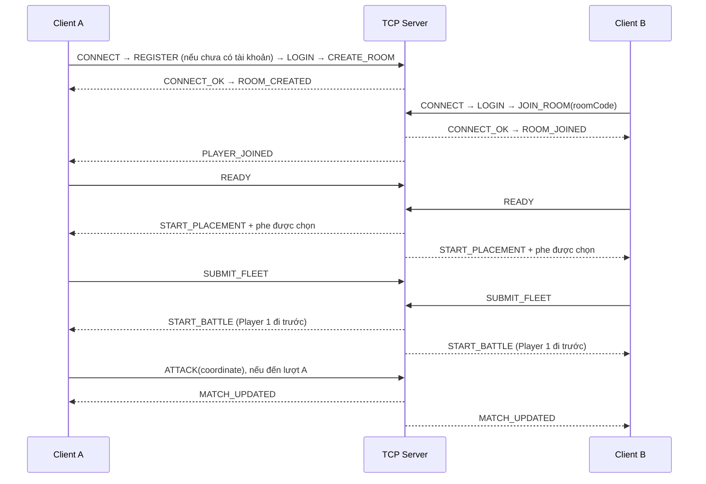

# Battleship 3D

Game desktop chiến thuật hải chiến trên bàn cờ 10×10, viết bằng **Java 25**.
Frontend dùng **jMonkeyEngine** để dựng không gian biển fantasy, lâu đài hai phe,
bàn cờ và mô hình tàu 3D. Backend dùng **Java TCP Socket** để quản lý phòng và trận PvP.

## Chức năng hiện có

- **Bắt buộc đăng nhập:** mở ứng dụng → đăng ký/đăng nhập → Main Menu. Không còn chế độ Play Local.
- **PvP:** tạo phòng, tham gia bằng mã 6 ký tự, phòng chờ hai người, Ready/Not Ready,
  xếp tàu và đánh trận qua TCP.
- Server chọn ngẫu nhiên phe trắng/đen khi bắt đầu xếp tàu; Player 1 trong phòng đi trước, độc lập với màu phe.
  Góc nhìn ban đầu của mỗi người hướng về lâu đài đối thủ.
- Kiểm tra vị trí tàu, giới hạn bàn cờ, chồng lấn, lượt bắn, hit/miss/sunk và thắng/thua.
- Hỗ trợ đặt mới, kéo thả, xoay, xóa, reset và random đội tàu; minimap và hiệu ứng bắn.

Mỗi đội gồm Carrier (5 ô), Battleship (4 ô), Cruiser (3 ô), Submarine (3 ô)
và Destroyer (2 ô). Tàu không được chồng lấn hoặc nằm ngoài bàn cờ.

Các nút PVE / VS AI, Friends và Settings hiện chỉ có giao diện,
chưa thực hiện chức năng (riêng **Profile** hiện mở tài khoản để đăng nhập/đăng xuất).
Đã có tài khoản và lưu kết quả PvP bằng PostgreSQL; chưa có chat hay khôi phục trận sau mất kết nối.

Kết thúc trận hiển thị Victory/Defeat theo từng người. **PLAY AGAIN** trong PvP
gửi yêu cầu đến server: một người đồng ý thì chờ trên màn kết quả, cả hai đồng ý
thì cùng về xếp tàu trong phòng hiện tại. Ván mới xóa đội hình, lịch sử bắn,
thắng/thua và timer cũ. **DECLINE** hủy yêu cầu đang chờ, giữ kết quả trận.
**MAIN MENU** rời phòng và về menu; nếu đối thủ còn ở màn kết quả, họ nhận
thông báo hủy chơi lại và vẫn giữ kết quả đó.

## Cấu trúc dự án

```text
LTM_battleship/
├── frontend/             # Client desktop, UI, input và render 3D
│   └── src/
│       ├── main/java/com/battleship/frontend/
│       │   ├── app/      # Khởi động và điều hướng màn hình
│       │   ├── menu/     # Main Menu
│       │   ├── pvp/      # Giao diện phòng và gửi lệnh PvP
│       │   ├── network/  # TCP client, luồng gửi/nhận
│       │   ├── game/     # Tương tác bàn cờ, HUD, minimap và hiển thị gameplay
│       │   └── ...       # camera, scene, graphics, effects
│       ├── main/resources/
│       └── test/java/
├── backend/              # Server, không cần giao diện hoặc GPU
│   └── src/main/java/com/battleship/backend/
│       ├── server/       # ServerSocket, kết nối và phiên client
│       ├── room/         # Thành viên, mã phòng, Ready và phân phe
│       ├── match/        # Trận PvP và repository lưu kết quả
│       ├── auth/         # Xác thực, password hashing và user repository
│       └── database/     # Cấu hình JDBC và migration
├── shared/               # Code thuần Java dùng chung
│   └── src/main/java/com/battleship/shared/
│       ├── game/         # Model và luật Battleship
│       ├── room/         # DTO và trạng thái phòng
│       ├── match/        # Lệnh và snapshot trận
│       └── protocol/     # Message, JSON codec và handshake
├── docs/                 # Ảnh tham chiếu và ảnh kiểm tra scene
├── gradle/               # Gradle Wrapper
├── settings.gradle
└── build.gradle
```

Frontend và backend cùng phụ thuộc `shared`. Shared không phụ thuộc jMonkeyEngine;
backend không phụ thuộc frontend. Luật chơi nằm trong `shared.game.GameEngine`;
server sở hữu trạng thái trận PvP. Renderer/UI không trực tiếp đọc hoặc ghi socket.

## Giao tiếp giữa các client

Hai client **không kết nối trực tiếp với nhau**. Mỗi client giữ một kết nối TCP
đến cùng backend; backend kiểm tra lệnh rồi đẩy cập nhật đến người trong phòng.



Server xác nhận đủ 5 tàu hợp lệ trước khi bắt đầu Battle. Đội hình sai bị từ chối
kèm lý do (thiếu/trùng loại tàu, thiếu dữ liệu, vượt biên hoặc chồng lấn); người chơi
có thể sửa và gửi lại. Kích thước tàu được server suy ra từ `ShipType`, không tin
kích thước hay danh sách ô do client tự khai báo. Người Ready trước chờ người còn lại,
đội hình đã xác nhận bị khóa. Player 1 là người ở vị trí đầu tiên trong phòng chờ.
Mỗi lượt bắn hợp lệ
được giải quyết trên server, sau đó đổi lượt kể cả khi bắn trúng.
Mỗi lượt PvP có **60 giây**, bắt đầu khi trận vào Battle và đặt lại sau mỗi phát
bắn hợp lệ. Bắn sai hoặc bắn trùng không đổi lượt, không đặt lại thời gian.
Hết giờ, người đang có lượt thua; server gửi kết quả cho cả hai client.
Mỗi người nhận snapshot riêng: toàn bộ board của mình, các ô đã bắn trên board
đối thủ và tàu đối thủ đã chìm; vị trí tàu chưa lộ không được gửi sang client.

### Protocol và đồng bộ

Message có ba trường, ví dụ lệnh bắn:

```json
{
  "type": "ATTACK",
  "requestId": "550e8400-e29b-41d4-a716-446655440000",
  "payload": { "coordinate": { "row": 2, "column": 4 } }
}
```

`row` và `column` bắt đầu từ 0. `requestId` liên kết phản hồi với yêu cầu tương ứng.
JSON được mã hóa UTF-8 và truyền theo frame:

```text
[4 byte độ dài JSON, big-endian][JSON UTF-8 đúng số byte đã khai báo]
```

Phần JSON tối đa 65.536 byte. Length prefix giúp đọc đúng message khi TCP chia
một message thành nhiều đoạn hoặc gộp nhiều message trong một lần nhận.

| Nhóm | Message chính |
| --- | --- |
| Kết nối | `CONNECT`, `CONNECT_OK`, `PING`, `PONG`, `DISCONNECT` |
| Tài khoản | `REGISTER`, `REGISTER_OK`, `LOGIN`, `LOGOUT`, `LOGOUT_OK`, `AUTH_SUCCESS`, `AUTH_FAILED` |
| Phòng | `CREATE_ROOM`, `JOIN_ROOM`, `ROOM_CREATED`, `ROOM_JOINED`, `PLAYER_JOINED`, `ROOM_UPDATED` |
| Sẵn sàng/rời phòng | `READY`, `NOT_READY`, `START_PLACEMENT`, `LEAVE_ROOM`, `ROOM_LEFT`, `PLAYER_LEFT` |
| Trận đấu | `SUBMIT_FLEET`, `FLEET_ACCEPTED`, `START_BATTLE`, `ATTACK`, `MATCH_UPDATED`, `TURN_TIMER` |
| Chơi lại | `REMATCH_REQUEST`, `REMATCH_DECLINE`, `REMATCH_UPDATED` |
| Lệnh bị từ chối | `ERROR` |

Gửi/nhận socket chạy ở thread riêng. Client chuyển sự kiện về render thread để
cập nhật UI an toàn, vẫn cập nhật khi cửa sổ mất focus. Server có hàng đợi gửi
giới hạn cho từng kết nối để socket chậm không chặn việc xử lý phòng.
Snapshot trận có `revision`; client bỏ qua bản lặp hoặc cũ.
Server dùng `System.nanoTime()` để quyết định hết giờ, đồng thời gửi `TURN_TIMER`
khoảng mỗi giây. Client chỉ nội suy thời gian còn lại để hiển thị, không tự xử
thắng/thua. Timeout và lệnh bắn được xử lý dưới cùng khóa; phát bắn được xử lý
tại hoặc sau deadline bị từ chối. Không có timer riêng tồn đọng từ lượt cũ.
Heartbeat `PING/PONG` duy trì kết nối. Khi một người rời hoặc mất kết nối trong Battle,
server xử thua người đó, gửi Victory cho đối thủ và lưu kết quả `PLAYER_LEFT`.
Trong Waiting Room/Placement, server cập nhật thành viên và đưa người còn lại về phòng chờ.
Nếu trận đã kết thúc, kết quả được giữ nguyên và yêu cầu chơi lại bị hủy.
Màn kết quả hiển thị lý do kết thúc: phá hủy hạm đội, hết giờ hoặc người chơi rời trận.
Timeout đã xảy ra được ưu tiên khi yêu cầu rời trận đến đúng/sau deadline; kết quả không bị ghi đè.

## Chạy sau khi clone

### Yêu cầu

- Git và **JDK 25**; cấu hình `JAVA_HOME` trỏ đến JDK 25.
- Frontend cần driver đồ họa hỗ trợ **OpenGL 3.2**; có thể dùng GPU onboard.
- Có Internet trong lần build đầu để tải Gradle và thư viện. Không cần cài Gradle riêng.
- Backend cần Java và PostgreSQL; Docker Desktop/Engine + Compose để chạy database. Không cần GPU.

Dự án dùng Gradle Wrapper 9.1.0, jMonkeyEngine 3.8.1-stable và Gson 2.13.2.

Thay `URL_REPOSITORY` bằng URL Git thực tế:

```bash
git clone URL_REPOSITORY LTM_battleship
cd LTM_battleship
java -version
```

Mở chính thư mục chứa `settings.gradle` trong IDE và import dưới dạng Gradle project.

### PostgreSQL và tài khoản

Chỉ PostgreSQL chạy trong Docker; Java backend/frontend vẫn chạy trực tiếp.
Tại thư mục gốc, sao chép cấu hình rồi đặt `DB_PASSWORD` riêng (không để trống):

```powershell
Copy-Item .env.example .env
# Sửa .env: DB_HOST, DB_PORT, DB_NAME, DB_USER, DB_PASSWORD
# Khởi động Docker Desktop trước, sau đó:
docker compose up -d --wait
docker compose ps
docker compose logs --tail=50 postgres
```

macOS/Linux dùng `cp .env.example .env`. `.env` đã được git-ignore.
Database chỉ được publish trên localhost; client không kết nối PostgreSQL.
Backend đọc `.env` trong thư mục chạy (hoặc thư mục gốc khi chạy từ `backend/`);
biến môi trường của tiến trình ưu tiên hơn file. Không đưa `.env` lên Git.
Khi triển khai bản `installDist`, đặt `.env` trong thư mục chạy hoặc export các biến `DB_*`.

Backend tự chạy script `backend/src/main/resources/db/V001__accounts_and_matches.sql`
trước khi mở TCP. Script chạy trong transaction, dùng khóa migration và `IF NOT EXISTS`;
chạy lại không xóa dữ liệu. Dữ liệu nằm trong named volume `postgres_data`.
Dừng/khởi động lại thông thường:

```powershell
docker compose stop postgres
docker compose start postgres
# Hoặc khởi động lại tiến trình PostgreSQL:
docker compose restart postgres
```

Không xóa volume khi dừng dịch vụ. Thay biến DB_USER/DB_PASSWORD sau khi volume đã có
không tự đổi tài khoản PostgreSQL đã khởi tạo; cần dùng đúng thông tin đã tạo hoặc đổi bằng SQL.

Ứng dụng mở thẳng form tài khoản. Phải đăng nhập thành công mới vào Main Menu và các chức năng game.
Dòng **SERVER: ... / CHANGE** mở form IP/hostname và TCP port: nhập địa chỉ backend,
chọn **CONNECT TO SERVER**, sau đó đăng nhập. Port phải từ 1 đến 65535; **BACK** hủy chỉnh sửa.
Gửi/nhận vẫn qua network layer riêng, không chặn render thread. Địa chỉ chỉ giữ trong lần chạy hiện tại;
tham số `-PserverHost`/`-PserverPort` vẫn dùng để chọn giá trị ban đầu.
Chọn **CREATE AN ACCOUNT**, nhập username/mật khẩu/xác nhận; đăng ký xong chuyển
về **SIGN IN** để đăng nhập. Username gồm 3–24 chữ ASCII, số hoặc `_`, không phân biệt
hoa/thường. Mật khẩu 12–128 ký tự. **PROFILE → SIGN OUT** đăng xuất; về Main Menu
vẫn giữ phiên đăng nhập. Không lưu mật khẩu trên đĩa phía client.
Đăng xuất đưa về form đăng nhập và khóa Main Menu. Trước khi đăng nhập, nút **EXIT** đóng ứng dụng; không có đường bỏ qua đăng nhập.

Server gắn tài khoản với kết nối TCP sau `AUTH_SUCCESS`; `CONNECT.playerName`, user ID
hoặc username tự thêm vào lệnh phòng không cấp quyền. Tất cả lệnh phòng/trận đều cần xác thực.
Một tài khoản chỉ có một phiên đăng nhập. Đăng xuất giải phóng phiên và rời phòng hiện tại.
Password hashing dùng PBKDF2-HMAC-SHA256, 600.000 vòng, salt ngẫu nhiên riêng 16 byte,
so sánh hằng thời gian; không lưu/gửi password hash về client.
Thông số theo [OWASP Password Storage](https://cheatsheetseries.owasp.org/cheatsheets/Password_Storage_Cheat_Sheet.html).
TCP hiện chưa mã hóa TLS: dùng mạng tin cậy/VPN khi truyền thông tin đăng nhập;
triển khai công khai cần lớp mã hóa TCP/TLS trước khi dùng tài khoản thật.

`users` lưu tài khoản và `last_seen_at` khi đăng nhập/đăng xuất; `matches` và `match_players` lưu thời gian, kết quả, nguyên nhân
(`FLEET_DESTROYED`, `TURN_TIMEOUT`, `PLAYER_LEFT`) cùng số phát bắn/hit/tàu chìm theo tài khoản.
Migration `V002__match_summary.sql` thêm `mode`, `winner_slot`, `total_turn`, `player_type`;
`total_turn` đếm số phát bắn hợp lệ đã xử lý, không tính lượt bỏ dở khi hết giờ hoặc rời trận.
Dữ liệu cũ được giữ và bổ sung tổng kết từ các thống kê đã có; lịch sử `ABORTED` cũ không bị đổi kết quả.
Chỉ bắt đầu ghi trận khi cả hai đội hình hợp lệ vào Battle; mỗi rematch có ID mới.
Ghi lịch sử chạy trong hàng đợi riêng, transaction; lỗi ghi được log, không chặn lượt bắn.
Chưa có màn hình lịch sử trận hoặc đặt lại mật khẩu trong phạm vi này.

### Windows / PowerShell

Build dự án:

```powershell
.\gradlew.bat build
```

Chạy client, đăng ký/đăng nhập rồi chọn **PVP** để chơi:

```powershell
.\gradlew.bat :frontend:run -PplayerName="Player A"
```

Thử PvP trên một máy: mở **ba terminal** tại thư mục gốc, mỗi terminal chạy một lệnh:

```powershell
# Terminal 1: server
.\gradlew.bat :backend:run
# Terminal 2: client A
.\gradlew.bat :frontend:run -PplayerName="Player A"
# Terminal 3: client B
.\gradlew.bat :frontend:run -PplayerName="Player B"
```

Mỗi client đăng ký/đăng nhập bằng **hai tài khoản khác nhau**. Trên client A chọn
**PVP → Create Room**; client B chọn **PVP → Join Room** và nhập mã.
Cả hai Ready trong Waiting Room để vào xếp tàu. Xếp đủ 5 tàu rồi Ready lần nữa;
server khóa đội tàu đã gửi và bắt đầu Battle khi cả hai hoàn tất.

### macOS / Linux

Dùng JDK 25 đúng kiến trúc máy và thay `.\gradlew.bat` bằng `sh gradlew`:

```bash
sh gradlew build
sh gradlew :backend:run
# Terminal khác:
sh gradlew :frontend:run -PplayerName="Player A"
```

Launcher frontend trên macOS thêm `-XstartOnFirstThread`.
Các kiểm tra 3D hiện đã chạy trên Windows; chưa xác nhận trực tiếp trên macOS/Linux.

### Hai máy khác nhau

Máy A chạy backend; client trên A có thể dùng mặc định `localhost:2209`.
Máy B clone cùng phiên bản source, cài JDK 25 và chạy:

```powershell
.\gradlew.bat :frontend:run -PserverHost=192.168.1.10 -PserverPort=2209 -PplayerName="Player B"
```

Thay `192.168.1.10` bằng IPv4 của máy A, xem bằng `ipconfig` trên Windows.
Hai máy phải truy cập được nhau; máy A cho phép inbound **TCP 2209** qua firewall.
`localhost` trên máy B chỉ đến chính máy B, không đến server trên A.

Nếu khác mạng Internet, dùng server có IP/domain truy cập được, hoặc VPN/port forwarding.
Mã phòng chỉ chọn phòng bên trong server, không tự tìm server hay vượt NAT.

| Tham số client | Mặc định | Ý nghĩa |
| --- | --- | --- |
| `-PserverHost=...` | `localhost` | IP/domain backend |
| `-PserverPort=...` | `2209` | TCP port backend |
| `-PplayerName="..."` | `Captain` | Tên handshake; tên trong game lấy từ tài khoản |

Đổi port server bằng `.\gradlew.bat :backend:run --args="2210"`, sau đó dùng
`-PserverPort=2210` cho các client. Khi chạy Java trực tiếp, các JVM property tương ứng
là `battleship.host`, `battleship.port`, `battleship.player`.

## Điều khiển

| Chuột/phím | Thao tác |
| --- | --- |
| Kéo chuột trái ở vùng biển trống | Orbit camera |
| Cuộn chuột / R | Zoom / reset camera |
| 1–5 hoặc chọn trong panel | Chọn loại tàu |
| Click ô trống | Đặt tàu mới |
| Kéo thả tàu đã đặt | Di chuyển tàu |
| T / Delete | Xoay / xóa tàu đang chọn |
| C / F | Reset / random đội tàu |
| Enter | Ready khi đủ 5 tàu |
| Click ô trong Battle | Gửi lệnh bắn |
| Tab | Đổi board đang xem |

Trong PvP, chỉ được bắn khi đến lượt mình và đang xem board đối thủ.

## Đóng gói backend lên server

```powershell
.\gradlew.bat :backend:build :backend:installDist
```

Upload **toàn bộ** `backend/build/install/backend/`, gồm `bin/` và `lib/`, lên máy chủ
có Java 25. Trên Linux, tại thư mục đã upload:

```bash
sh bin/backend 2209
```

Mở TCP port tương ứng trong firewall/security group; dùng IP/domain máy chủ làm
`serverHost` của tất cả client. Khi vận hành lâu dài, chạy backend dưới service manager
như systemd. Server cần hỗ trợ TCP trực tiếp; frontend 3D vẫn chạy trên máy người chơi.
Phòng/trận đang chơi lưu trong RAM; khởi động lại server mất trạng thái đang chơi.
Tài khoản và lịch sử trận đã ghi vẫn giữ trong PostgreSQL.

## Kiểm tra và xử lý lỗi

`build` chạy kiểm tra luật chơi, mapping tọa độ và password hashing, không cần database.
Kiểm tra PostgreSQL/TCP chạy riêng khi database đã healthy và `.env` đã cấu hình:

```powershell
.\gradlew.bat build -PdatabaseChecks
```

Lệnh trên kiểm tra đăng ký/login/logout, username trùng, identity giả, phiên trùng,
migration lặp, hash trong database, thống kê trận và các trận TCP/rematch.
Các kiểm tra tạo tài khoản QA với tên duy nhất trong database phát triển.
Các kiểm tra giao diện cần môi trường OpenGL:

```powershell
.\gradlew.bat :frontend:checkGameplayRendering :frontend:checkMainMenu
# Cần backend chạy riêng tại localhost:2209:
.\gradlew.bat :frontend:checkPvpRooms
.\gradlew.bat :frontend:checkAccountScreens
.\gradlew.bat :frontend:checkPvpDisconnect
```

| Vấn đề | Kiểm tra |
| --- | --- |
| Không tìm thấy JDK 25 | Kiểm tra `java -version`, `JAVA_HOME` và Gradle JVM trong IDE |
| Connection refused / timeout | Server đã chạy, đúng IP/port, firewall và đường mạng có cho phép TCP không |
| Port đã được sử dụng | Dừng server cũ hoặc chọn port khác cho cả server/client |
| Không tạo được OpenGL context | Cập nhật driver GPU; Windows có thể thử `.\gradlew.bat :frontend:runIntegrated` |

Windows launcher ưu tiên GPU hiệu năng cao và thử onboard nếu khởi tạo OpenGL thất bại;
không bật/tắt thiết bị GPU. Onboard vẫn cần driver OpenGL hoạt động.
Frontend và backend nên dùng cùng phiên bản source/protocol.

Font Cormorant Garamond và Manrope có giấy phép SIL OFL trong
`frontend/src/main/resources/fonts/`.
